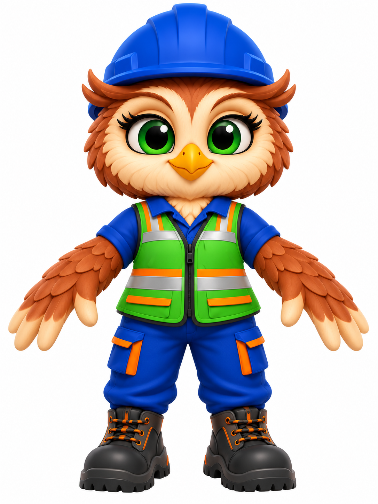
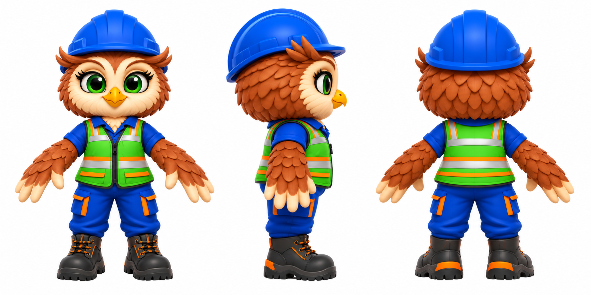

# Ecasio (mascote do Grupo ECASI)

A coruja operária da ECASI. As imagens de conceito foram geradas no ChatGPT em 02/11/2026 e aprovadas pelo usuário. É daqui que sai o boneco 3D.

## Imagens

| Arquivo | O que é |
|---|---|
| `ref/ecasio-original.jpeg` | mascote oficial (joinha, prancheta e logos) |
| `ref/prompts-chatgpt.md` | prompts usados no ChatGPT |
| `conceito/frente.png` | frente em pose A, mãos vazias, sem logo (base do 3D) |
| `conceito/turnaround.png` | folha com frente, lado direito e costas |

## Visual

- Coruja de penas marrom-avermelhadas, com rosto e peito creme, olhos verdes grandes com cílios e bico amarelo-alaranjado.
- Capacete azul, uniforme azul royal, calça cargo com detalhes laranja, colete verde com faixas refletivas e botinas pretas com laranja.
- As asas são braços com "mão" de 5 penas-dedos.
- No modelo base, o capacete e o colete ficam sem logo. A ECASI entra depois como adesivo nítido (ver a etapa 6 da skill `bonequinho-3d`).

## Status do 3D (gerado em 02/11/2026)

- **Modelo:** `final/ecasio.glb` (copiado de `modelo/bruto_multi.glb`).
  - Gerado no TRELLIS, no modo multi-imagem, com `conceito/vista-frente-turn.png`, `vista-lado.png` e `vista-costas.png` recortados do turnaround.
  - Malha de 52 mil faces, textura 2048, gerada em 124 s.
  - Script: `tools/gerar_3d.py`, com `SIMPLIFY=0.8 TEXTURA=2048`.
  - O rosto saiu bom, então não precisou de reprojeção (`tools/reprojetar_textura.py` fica de reserva).
- **Esqueleto:** `componentes-3d/personagens/ecasio-rig.js` (`criarEcasio`, `POSES`, `misturar`).
  - Usa os mesmos ossos e movimentos do pintor; as articulações foram medidas em fatias da malha.
  - Tem a pose extra `prancheta` e o passo mais curto no `andar`.
- **Prévia das poses:** `final/preview/poses/shots/` (projeto HyperFrames em `final/preview/poses/`).
- **Prancheta:** `prancheta()` em `componentes-3d/props-seguranca.js`. No vídeo, ela acompanha a mão direita a cada quadro, mas fica sempre de pé, para dar para ler.
- **Primeiro vídeo:** `ecasi/videos/nr01-ecasio/`.

Limitações conhecidas:
- As asas giram como braços humanos. Poses com o antebraço muito dobrado (`pensar`, `joinha`) ficam parecidas com `explicar`.
- Não há animação de rosto (piscar, bico falando).
